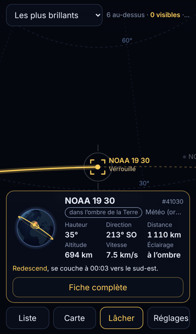
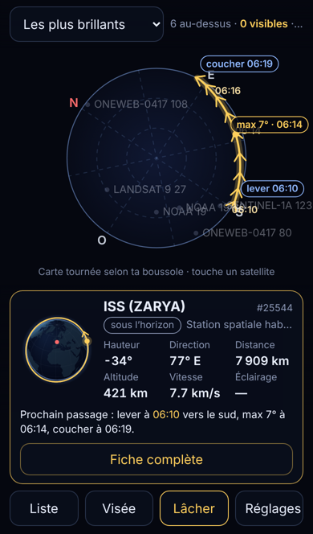
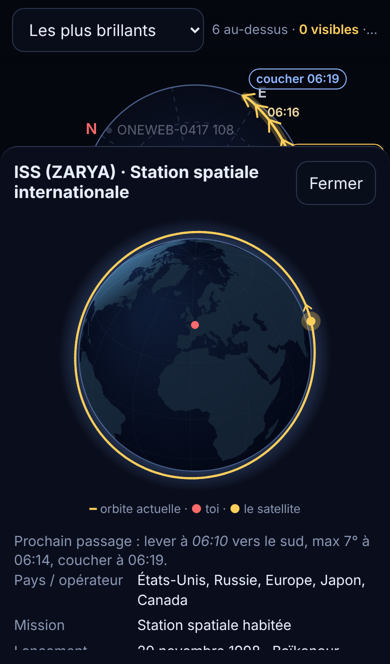

# SatSky

**Vise le ciel avec ton téléphone et vois les satellites qui passent, en direct.**

👉 **https://thomaspoum.github.io/satsky/** — à ouvrir sur mobile, puis « Ajouter à l'écran d'accueil ».

SatSky est une PWA sans serveur : elle récupère les orbites publiques, calcule la position de chaque satellite dans le téléphone et les superpose à l'image de la caméra, à l'endroit exact où ils se trouvent.

<p>
  
  
  
  
</p>

<sub>Captures réalisées avec des données de démonstration.</sub>

## Ce que ça fait

- **Visée en réalité augmentée** : caméra arrière, horizon, points cardinaux et hauteurs. Les satellites sont colorés selon qu'ils sont **visibles à l'œil nu** (ambre), éclairés mais avec un ciel trop clair (bleu) ou dans l'ombre de la Terre (gris).
- **Verrouillage automatique** : garde un satellite 2 s dans le réticule, un anneau se remplit, puis la cible se verrouille avec une vibration. Pendant la visée, seul son nom s'affiche, pour garder la vue dégagée. Vise un autre satellite et le précédent se libère. « Lâcher » efface la fiche et la trajectoire en fondu. Tu peux aussi toucher un satellite ou le chercher dans la liste.
- **Trajectoire et orbite dans le ciel** : le passage se dessine depuis la position actuelle, avec des repères de minutes, la culmination et l'heure de coucher. Une flèche indique la direction du satellite. L'orbite complète se projette aussi dans le ciel : en ambre au-dessus de l'horizon, en pointillés bleus « à travers le sol » en dessous. Si le satellite est hors champ, une flèche indique où tourner.
- **Orbite sur un globe** : le mini-globe montre l'orbite autour de la Terre, ta position, le satellite et la nuit en cours.
- **Contexte** : pays ou opérateur, date et lieu de lancement, type d'orbite, résumé de la mission, science et enjeux pour une quarantaine de familles (stations, Hubble, Starlink, GPS, Galileo, météo, Copernicus, débris…), plus un extrait de Wikipédia quand il existe.
- **Carte du ciel** : vue de dessus, tournée selon la boussole, pour quand on n'a pas envie de lever le bras.
- **Hors ligne** : l'app et les dernières orbites restent en cache.

## Comment la visée reste stable

Les capteurs d'un téléphone sont bruités, et la boussole est la plus mauvaise quand on tient le téléphone à la verticale, justement pour viser. SatSky combine :

1. **Quaternions** pour représenter l'orientation, plutôt que trois angles : pas de saut au passage 359°/0°, et pas d'instabilité quand le téléphone est vertical.
2. **Filtre « 1 € »** ([Casiez et al., CHI 2012](https://cristal.univ-lille.fr/~casiez/1euro/)) : lissage fort quand le téléphone est presque immobile, pour tuer le tremblement, et réactif dès qu'on bouge.
3. **Fusion gyroscope et boussole, sur iOS comme sur Android** : le gyroscope, fluide et sans sauts, pilote le mouvement. La boussole (`webkitCompassHeading` sur iOS, `deviceorientationabsolute` sur Android), juste mais bruitée, ne fait que recaler le nord, lentement. Ses sursauts de plus de 20° sont ignorés s'ils durent moins de 1,5 s, et elle n'est pas écoutée quand on vise près du zénith, où le cap bascule.
4. **Rendu à 60 images/s découplé des capteurs**, avec une position des satellites extrapolée entre deux calculs SGP4.
5. **Visée « aimantée »** : la cible acquise reste prioritaire tant qu'elle est proche du centre, et une perte brève (moins de 0,4 s) met le verrouillage en pause au lieu de le remettre à zéro.

Un réglage « Correction du nord » permet de recaler la boussole sur un repère connu, comme la Lune, et un autre ajuste le champ de vision de la caméra.

## Données d'orbite : un miroir plutôt que 1 000 téléphones

CelesTrak limite les gros groupes (Starlink, Active) et renvoie une erreur HTTP 403 quand on les retélécharge trop souvent. Si chaque téléphone allait directement chez CelesTrak, Starlink finissait bloqué.

La GitHub Action `Orbites (miroir CelesTrak)` télécharge donc chaque groupe **une fois toutes les 4 heures**, poliment, et les publie sur la branche `data`, sans historique. L'app lit ce miroir en premier, puis CelesTrak en secours, puis son cache local.

Les gros groupes sont préparés par tranches et le calcul SGP4 est étalé sur plusieurs images (environ 6 ms par image). La visée reste fluide même avec les quelque 9 000 satellites Starlink.

## Mars en 3D

👉 **https://thomaspoum.github.io/satsky/mars/** : une planète Mars autour de laquelle on tourne, et sur laquelle on descend en zoomant.

- **Relief réel** : altimétrie laser MOLA (Mars Global Surveyor, NASA), 1,85 km par point, dans la géométrie et dans l'éclairage. L'exagération se règle de ×1 à ×10.
- **Niveaux de détail** : un arbre de tuiles charge des données plus fines à mesure qu'on s'approche (981 tuiles, 20 Mo en tout, quelques centaines de ko pour la vue globale).
- **Soleil et atmosphère** : heure solaire, saison, rotation de la planète, brume de poussière, lueur bleue du coucher de Soleil.
- **Lieux** : volcans, bassins, sites d'atterrissage ; un clic y emmène.
- **Vol** : glisser déplace à altitude constante (on ne plonge pas dans les ravins), clic droit ou deux doigts pour tourner autour du point visé, Maj + glisser ou le bouton « Regarder » pour tourner la caméra sur place, ZQSD/WASD, R et F au clavier.
- **Nouvelle-Arès** : une ville imaginaire au fond de Melas Chasma (11,2° S, 70° O), construite par programme dans `mars/city.js` : dômes, tours, astroport, et deux bases militaires. Le terrain y est aplani ; tout le reste de la planète est conforme aux mesures.

Sous 2 km par point environ, le sol est complété par un grain fractal : ce détail-là n'est pas mesuré.

Les tuiles de `mars/data` se refabriquent avec `python3 scripts/build-mars.py megt90n000fb.img 8k_mars.jpg mars/data` (sources : [MOLA MEGDR](https://pds-geosciences.wustl.edu/missions/mgs/megdr.html), domaine public ; [carte couleur Solar System Scope](https://www.solarsystemscope.com/textures/), CC BY 4.0). Le rendu utilise [three.js](https://threejs.org) (MIT).

## Lancer en local

```bash
npm install
npm run serve          # http://localhost:8765
```

La caméra, la boussole et le GPS demandent du **HTTPS** sur mobile. Pour tester sur ton téléphone, ouvre un tunnel, par exemple `cloudflared tunnel --url http://localhost:8765`.

## Tests

```bash
npm test               # tests unitaires (node:test) : Soleil, ombre, quaternions, filtre, projection, TLE, orbites, contexte
npm run test:e2e       # tests de bout en bout (Playwright, réseau simulé) : verrouillage, changement de cible,
                       # libération, tremblement, liste, fiche, carte, secours CelesTrak, fluidité avec 9 000 satellites
```

Les deux suites tournent dans GitHub Actions à chaque push.

## Organisation

| Fichier | Rôle |
|---|---|
| `index.html` | Interface, rendu canvas, capteurs, animations |
| `core.js` | Calculs purs partagés avec les tests : Soleil, ombre, quaternions, filtre, projection, orbites |
| `kb.js` | Contexte éditorial des satellites, codes pays et sites de lancement |
| `land.js` | Contours des continents pour le globe (Natural Earth 110m) |
| `satellite.min.js` | [satellite.js](https://github.com/shashwatak/satellite-js) 5.0.0, propagation SGP4 |
| `sw.js`, `manifest.webmanifest` | PWA : installation et cache hors ligne |
| `scripts/fetch-tle.mjs` | Miroir des orbites, lancé toutes les 4 h par GitHub Actions |
| `tests/` | Tests unitaires et de bout en bout |

## Données et crédits

- Orbites (TLE) et catalogue des objets : [CelesTrak](https://celestrak.org). Les orbites passent par un miroir rafraîchi toutes les 4 h et restent 3 h en cache sur le téléphone ; le catalogue reste 30 jours en cache.
- Extraits encyclopédiques : [Wikipédia](https://fr.wikipedia.org), sous licence CC BY-SA, avec un lien vers chaque article.
- Contours des continents : [Natural Earth](https://www.naturalearthdata.com), domaine public, via world-atlas.
- Propagation : satellite.js (MIT).

## Limites connues

- La précision dépend de la boussole du téléphone : quelques degrés en général, davantage près d'objets métalliques ou d'une coque aimantée.
- Le champ de vision de la caméra varie selon les modèles : ajuste-le dans les réglages si les points glissent quand tu tournes.
- Les orbites ont quelques heures : une précision de l'ordre de la seconde d'arc n'est pas le but.
