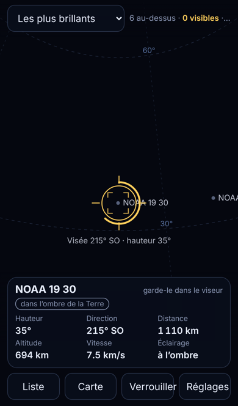

# SatSky

**Vise le ciel avec ton téléphone et vois les satellites qui passent, en direct.**

👉 **https://thomaspoum.github.io/satsky/** — à ouvrir sur mobile, puis « Ajouter à l'écran d'accueil ».

SatSky est une PWA sans serveur : elle récupère les orbites publiques, calcule la position de chaque satellite dans le téléphone et les superpose à l'image de la caméra, à l'endroit exact où ils se trouvent.

<p>
  
  
  
  
</p>

<sub>Captures réalisées avec des données de démonstration.</sub>

## Ce que ça fait

- **Visée en réalité augmentée** : caméra arrière, horizon, points cardinaux et hauteurs. Les satellites sont colorés selon qu'ils sont **visibles à l'œil nu** (ambre), éclairés mais avec un ciel trop clair (bleu) ou dans l'ombre de la Terre (gris).
- **Verrouillage automatique** : garde un satellite 2 s dans le réticule, un anneau se remplit, puis la cible se verrouille avec une vibration. Tu peux aussi toucher un satellite ou le chercher dans la liste.
- **Trajectoire du passage** : le chemin dans le ciel se dessine depuis la position actuelle, avec le sens du mouvement, des repères de minutes, la culmination et l'heure de coucher. Si le satellite est hors champ, une flèche indique où tourner.
- **Orbite sur un globe** : le mini-globe montre l'orbite autour de la Terre, ta position, le satellite et la nuit en cours.
- **Contexte** : pays ou opérateur, date et lieu de lancement, type d'orbite, résumé de la mission, science et enjeux pour une quarantaine de familles (stations, Hubble, Starlink, GPS, Galileo, météo, Copernicus, débris…), plus un extrait de Wikipédia quand il existe.
- **Carte du ciel** : vue de dessus, tournée selon la boussole, pour quand on n'a pas envie de lever le bras.
- **Hors ligne** : l'app et les dernières orbites restent en cache.

## Comment la visée reste stable

Les capteurs d'un téléphone sont bruités, et la boussole est la plus mauvaise quand on tient le téléphone à la verticale, justement pour viser. SatSky combine :

1. **Quaternions** pour représenter l'orientation, plutôt que trois angles : pas de saut au passage 359°/0°, et pas d'instabilité quand le téléphone est vertical.
2. **Filtre « 1 € »** ([Casiez et al., CHI 2012](https://cristal.univ-lille.fr/~casiez/1euro/)) : lissage fort quand le téléphone est presque immobile, pour tuer le tremblement, et réactif dès qu'on bouge.
3. **Fusion gyroscope et boussole sur iOS** : le gyroscope, fluide, donne le mouvement. La boussole (`webkitCompassHeading`), juste mais bruitée, ne corrige le nord que lentement, et moins encore quand sa précision annoncée est mauvaise.
4. **Rendu à 60 images/s découplé des capteurs**, avec une position des satellites extrapolée entre deux calculs SGP4.
5. **Visée « aimantée »** : la cible acquise reste prioritaire tant qu'elle est proche du centre, et une perte brève (moins de 0,4 s) met le verrouillage en pause au lieu de le remettre à zéro.

Un réglage « Correction du nord » permet de recaler la boussole sur un repère connu, comme la Lune, et un autre ajuste le champ de vision de la caméra.

## Lancer en local

```bash
npm install
npm run serve          # http://localhost:8765
```

La caméra, la boussole et le GPS demandent du **HTTPS** sur mobile. Pour tester sur ton téléphone, ouvre un tunnel, par exemple `cloudflared tunnel --url http://localhost:8765`.

## Tests

```bash
npm test               # tests unitaires (node:test) : Soleil, ombre, quaternions, filtre, projection, TLE, orbites, contexte
npm run test:e2e       # tests de bout en bout (Playwright, réseau simulé) : verrouillage, tremblement, liste, fiche, carte
```

Les deux suites tournent dans GitHub Actions à chaque push.

## Organisation

| Fichier | Rôle |
|---|---|
| `index.html` | Interface, rendu canvas, capteurs, animations |
| `core.js` | Calculs purs partagés avec les tests : Soleil, ombre, quaternions, filtre, projection, orbites |
| `kb.js` | Contexte éditorial des satellites, codes pays et sites de lancement |
| `land.js` | Contours des continents pour le globe (Natural Earth 110m) |
| `satellite.min.js` | [satellite.js](https://github.com/shashwatak/satellite-js) 5.0.0, propagation SGP4 |
| `sw.js`, `manifest.webmanifest` | PWA : installation et cache hors ligne |
| `tests/` | Tests unitaires et de bout en bout |

## Données et crédits

- Orbites (TLE) et catalogue des objets : [CelesTrak](https://celestrak.org), mis en cache 6 h pour les orbites et 30 jours pour le catalogue.
- Extraits encyclopédiques : [Wikipédia](https://fr.wikipedia.org), sous licence CC BY-SA, avec un lien vers chaque article.
- Contours des continents : [Natural Earth](https://www.naturalearthdata.com), domaine public, via world-atlas.
- Propagation : satellite.js (MIT).

## Limites connues

- La précision dépend de la boussole du téléphone : quelques degrés en général, davantage près d'objets métalliques ou d'une coque aimantée.
- Le champ de vision de la caméra varie selon les modèles : ajuste-le dans les réglages si les points glissent quand tu tournes.
- Les orbites ont quelques heures : une précision de l'ordre de la seconde d'arc n'est pas le but.
